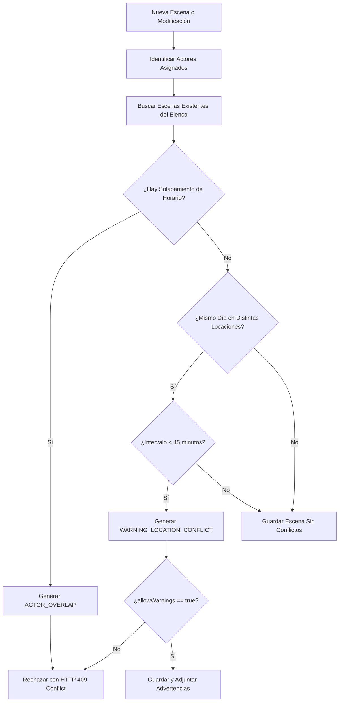

# 🎬 StudioFlow Backend

Backend robusto, modular y de nivel empresarial para **StudioFlow**, la plataforma integral de gestión de producciones audiovisuales (películas, series, videoclips y documentales).

Diseñado bajo principios de **Clean Architecture**, **Domain-Driven Design (DDD)** y seguridad estricta basada en roles (**RBAC**) con **Spring Security & JWT**, conectado a **PostgreSQL en Supabase**.

---

## 🚀 Características Principales

1. **Gestión Integral de Producciones**:
   - Seguimiento del estado global de avance (`progressPercentage`) calculado automáticamente según escenas completadas vs. totales.
   - Control presupuestario en tiempo real (`spentBudget` vs. `totalBudget`), recalculado al modificar costes de escenas.

2. **Plan de Rodaje Diario (Daily Call Sheet)**:
   - Consulta cronológica de escenas programadas por hora para cualquier fecha.
   - Estados de rodaje visuales: 🟢 `READY`, 🟡 `DELAYED`, 🔴 `PROBLEM`, y `COMPLETED`.

3. **Asignación de Recursos & Elenco**:
   - Asignación de actores a escenas mediante tabla intermedia `scene_actors`.
   - Validación estricta para garantizar que solo usuarios con rol `ACTOR` puedan ser asignados al elenco.

4. **Motor Inteligente de Detección de Conflictos (Core Feature)**:
   - **Conflicto Crítico de Solapamiento (`ACTOR_OVERLAP`)**: Detecta si un actor está citado en dos escenas simultáneas. Bloquea el guardado para evitar citaciones imposibles.
   - **Alerta de Traslado entre Locaciones (`WARNING_LOCATION_CONFLICT`)**: Si un actor tiene dos escenas el mismo día en locaciones distintas con un intervalo menor al tiempo mínimo de traslado (ej. < 45 minutos), genera una alerta detallada.
   - **Modo Flexible / Validador en Tiempo Real**: Endpoint `POST /api/v1/scenes/validate-conflicts` para simulación en vivo desde interfaces drag-and-drop del frontend sin persistir en base de datos.

5. **Seguridad y Control de Acceso Basado en Roles (RBAC)**:
   - `PRODUCER`: Control total financiero, de personal, producciones y escenas.
   - `DIRECTOR`: Planificación de escenas, actualización de estados de rodaje y notas.
   - `CREW`: Consulta de agenda diaria, locaciones y requerimientos técnicos.
   - `ACTOR`: Consulta de horario de citación y escenas asignadas.

---

## 🛠️ Stack Tecnológico

- **Lenguaje**: Java 17+ (Compatible con JDK 17, 21 y 25)
- **Framework**: Spring Boot 3.3.5
- **Persistencia**: Spring Data JPA & Hibernate
- **Base de Datos**: PostgreSQL (Supabase)
- **Seguridad**: Spring Security 6 + JSON Web Tokens (JJWT 0.12.6)
- **Validación**: Jakarta Bean Validation (`@Valid`)
- **Productividad**: Project Lombok
- **Testing**: JUnit 5, Mockito, Spring Boot Test, H2 In-Memory (modo PostgreSQL)
- **Build Tool**: Apache Maven

---

## 📐 Estructura del Proyecto (Clean Architecture)

```
c:\Studio_flow
├── src/
│   ├── main/
│   │   ├── java/com/studioflow/
│   │   │   ├── StudioFlowApplication.java
│   │   │   ├── config/             # Configuración de Seguridad, CORS y Beans
│   │   │   │   └── SecurityConfig.java
│   │   │   ├── controller/         # Controladores REST API
│   │   │   │   ├── AuthController.java
│   │   │   │   ├── HealthController.java
│   │   │   │   ├── ProductionController.java
│   │   │   │   └── SceneController.java
│   │   │   ├── dto/                # Data Transfer Objects (Requests & Responses)
│   │   │   │   ├── auth/           # LoginRequest, RegisterRequest, AuthResponse
│   │   │   │   ├── common/         # ErrorResponse
│   │   │   │   ├── conflict/       # ConflictDetail, ConflictType
│   │   │   │   ├── production/     # ProductionRequest, ProductionResponse
│   │   │   │   ├── scene/          # SceneRequest, SceneResponse, DailyScheduleResponse
│   │   │   │   └── user/           # UserResponse
│   │   │   ├── exception/          # Manejador global y excepciones de negocio
│   │   │   │   ├── BadRequestException.java
│   │   │   │   ├── EmailAlreadyExistsException.java
│   │   │   │   ├── GlobalExceptionHandler.java
│   │   │   │   ├── ResourceNotFoundException.java
│   │   │   │   ├── ScheduleConflictException.java
│   │   │   │   └── UnauthorizedActionException.java
│   │   │   ├── model/              # Entidades JPA (Dominio)
│   │   │   │   ├── Production.java
│   │   │   │   ├── Role.java
│   │   │   │   ├── Scene.java
│   │   │   │   ├── SceneStatus.java
│   │   │   │   └── User.java
│   │   │   ├── repository/         # Interfaces Spring Data JPA
│   │   │   │   ├── ProductionRepository.java
│   │   │   │   ├── SceneRepository.java
│   │   │   │   └── UserRepository.java
│   │   │   ├── security/           # Filtro JWT, UserDetails y utilitarios
│   │   │   │   ├── CustomUserDetails.java
│   │   │   │   ├── CustomUserDetailsService.java
│   │   │   │   ├── JwtAuthenticationEntryPoint.java
│   │   │   │   ├── JwtAuthenticationFilter.java
│   │   │   │   └── JwtUtils.java
│   │   │   └── service/            # Lógica de negocio y motor de conflictos
│   │   │       ├── AuthService.java
│   │   │       ├── ProductionService.java
│   │   │       ├── SceneService.java
│   │   │       ├── conflict/
│   │   │       │   ├── ConflictDetectionEngine.java
│   │   │       │   └── ConflictDetectionEngineImpl.java
│   │   │       └── impl/
│   │   │           ├── AuthServiceImpl.java
│   │   │           ├── ProductionServiceImpl.java
│   │   │           └── SceneServiceImpl.java
│   │   └── resources/
│   │       ├── application.yml     # Configuración con variables de entorno
│   │       └── schema.sql          # DDL para Supabase PostgreSQL
│   └── test/
│       ├── java/com/studioflow/    # Tests unitarios e integración
│       └── resources/
│           └── application-test.yml# Configuración para testing aislado
├── .env.example
├── .gitignore
├── pom.xml
└── README.md
```

---

## ⚡ Configuración con Supabase (PostgreSQL)

1. En tu proyecto de **[Supabase](https://supabase.com)**, dirígete a:
   `Project Settings -> Database -> Connection string -> JDBC / URI`.
2. Define las siguientes variables de entorno (o crea un archivo `.env` basado en `.env.example`):

```bash
# Variables de Entorno para Producción / Desarrollo
SUPABASE_DB_URL=jdbc:postgresql://db.[YOUR-PROJECT-REF].supabase.co:5432/postgres?sslmode=require
SUPABASE_DB_USER=postgres
SUPABASE_DB_PASSWORD=[TU_PASSWORD_DE_SUPABASE]

# Clave secreta para JWT (HMAC-SHA256, mínimo 256 bits)
JWT_SECRET=404E635266556A586E3272357538782F413F4428472B4B6250645367566B5970
JWT_EXPIRATION_MS=86400000

# Margen mínimo de traslado entre locaciones (en minutos)
MINIMUM_TRAVEL_MINUTES=45
PORT=8080
```

> **Tip:** También puedes ejecutar el archivo `src/main/resources/schema.sql` directamente en el **SQL Editor** de Supabase para pre-crear tablas e índices optimizados.

---

## 🔑 Matriz de Permisos (RBAC)

| Endpoint | Método | Roles Permitidos | Propósito |
| :--- | :---: | :---: | :--- |
| `/api/v1/auth/register` | `POST` | Público | Registro de usuarios |
| `/api/v1/auth/login` | `POST` | Público | Autenticación y obtención de JWT |
| `/api/v1/auth/me` | `GET` | Autenticado | Perfil del usuario actual |
| `/api/v1/auth/actors` | `GET` | Autenticado | Directorio de actores para casting |
| `/api/v1/productions` | `POST` | `PRODUCER` | Crear nueva producción |
| `/api/v1/productions` | `GET` | `PRODUCER`, `DIRECTOR`, `CREW` | Listar producciones |
| `/api/v1/productions/{id}` | `GET` | Todos | Ver detalle y métricas de producción |
| `/api/v1/productions/{id}` | `PUT` | `PRODUCER` | Actualizar producción y presupuesto |
| `/api/v1/productions/{id}` | `DELETE` | `PRODUCER` | Eliminar producción |
| `/api/v1/productions/{id}/schedule` | `GET` | Todos | Plan de rodaje diario (Call Sheet) |
| `/api/v1/productions/{id}/conflicts` | `GET` | `PRODUCER`, `DIRECTOR` | Auditoría de conflictos globales |
| `/api/v1/scenes` | `POST` | `PRODUCER`, `DIRECTOR` | Programar escena (con detección de conflictos) |
| `/api/v1/scenes/{id}` | `GET` | Todos | Consultar detalle de escena |
| `/api/v1/scenes/{id}` | `PUT` | `PRODUCER`, `DIRECTOR` | Modificar escena y re-evaluar conflictos |
| `/api/v1/scenes/{id}/status` | `PATCH` | `PRODUCER`, `DIRECTOR` | Actualizar estado (`READY`, `DELAYED`, `PROBLEM`, `COMPLETED`) |
| `/api/v1/scenes/{id}` | `DELETE` | `PRODUCER` | Eliminar escena |
| `/api/v1/scenes/validate-conflicts` | `POST` | `PRODUCER`, `DIRECTOR` | Validación en tiempo real (dry-run) |
| `/api/v1/scenes/actor/{actorId}` | `GET` | Todos | Horario de citaciones del actor |

---

## 🧠 Motor de Detección de Conflictos

El motor se activa automáticamente en cada creación o reprogramación de escenas:



---

## 🧪 Pruebas Automatizadas

El proyecto incluye una suite completa de pruebas unitarias y de integración que cubren:
- Detección de solapamiento de horarios simultáneos de actores.
- Detección de tiempos insuficientes de traslado entre locaciones (`WARNING_LOCATION_CONFLICT`).
- Recálculo financiero y porcentaje de avance.
- Autenticación JWT, rechazo de credenciales y prevención de emails duplicados.
- Control de acceso por roles (RBAC) asegurando que roles no autorizados reciban `403 Forbidden`.

Para ejecutar las pruebas:
```bash
mvn clean test
```

---

## 📦 Ejecución del Proyecto

### Requisitos Previos
- Java 17 o superior instalado (`java -version`).
- Maven 3.9+ (`mvn -version`).

### Compilar y Ejecutar
```bash
# Compilar el proyecto
mvn clean package -DskipTests

# Ejecutar el servidor
java -jar target/studioflow-backend-1.0.0.jar
# o directamente vía Maven:
mvn spring-boot:run
```

El servidor iniciará en `http://localhost:8080`.
